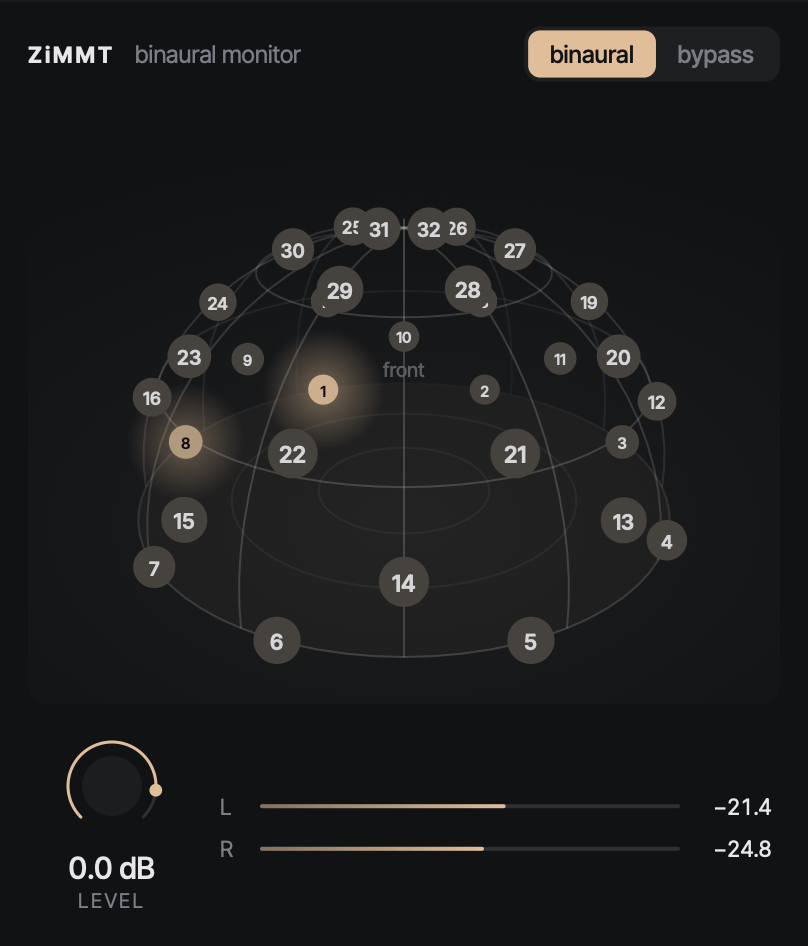
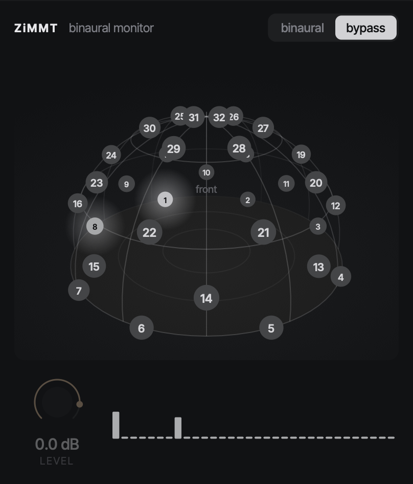

# ZiMMT Binaural Monitor

A real-time binaural monitor for the 32-channel hemispherical loudspeaker array of the Center for Immersive Media Art, Music and Technology (ZiMMT) in Leipzig. The plugin performs partitioned convolution using measured BRIRs from a dummy head equipped with DPA microphones, enabling binaural monitoring of spatial audio productions.

<p align="center">
  
  
</p>

## Download

Pre-built binaries for Windows, macOS, and Linux are available on the [Releases page](https://github.com/ZiMMT-Lab/ZiMMTBinauralMonitor/releases).

## Build Instructions

### Prerequisites
- CMake 3.22 or higher
- C++ compiler with C++17 support
- Git

### Building from Source
```bash
git clone --recursive https://github.com/ZiMMT-Lab/ZiMMTBinauralMonitor.git
cd ZiMMTBinauralMonitor
git submodule update --init --recursive  
cmake -B build -DCMAKE_BUILD_TYPE=Release
cmake --build build --config Release
```

Built plugins will be located in:
- **VST3**: `build/ZiMMTBinauralMonitor_artefacts/Release/VST3/`
- **Standalone**: `build/ZiMMTBinauralMonitor_artefacts/Release/Standalone/`

## License

This project is licensed under the GNU Affero General Public License v3.0 - see the [LICENSE](LICENSE) file for details.